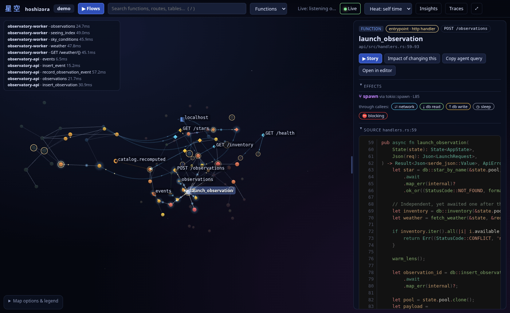
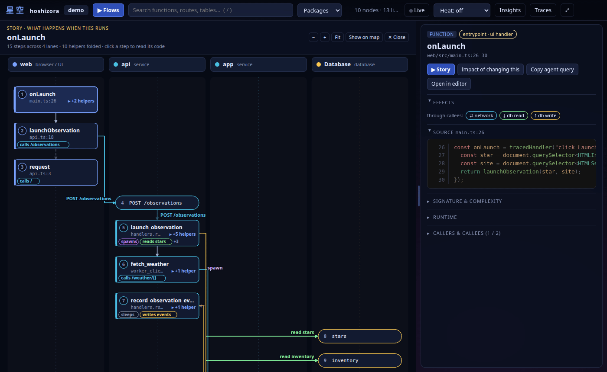

# hoshizora 星空

Maps a codebase as a 3D graph of modules and functions and overlays OpenTelemetry traces.

[](https://github.com/DorskFR/hoshizora/actions/workflows/ci.yml)



^ The [demo](examples/demo) with live spans. Colour is self time; the panel lists the direct and
transitive effects of `launch_observation`.

Parses a repository with tree-sitter into packages, files, types and functions, with each
function's effects (network, SQL by table, filesystem, spawns, locks, blocking calls in
async code) and cross-service paths from a frontend `fetch` to the SQL. OpenTelemetry spans add
self time and percentiles per function.

```sh
hoshizora index path/to/repo          # parse it, write .hoshizora/graph.json
hoshizora serve                       # API, OTLP receiver and the 3D viewer on :7317
hoshizora query flow '<node id>'      # everything a function or route triggers, as JSON
hoshizora query insights              # N+1 queries, sequential awaits, quadratic loops
hoshizora diff ./base ./head          # what a change does to effects, tables and entrypoints
```

## FAQ

| Question | Answer |
|---|---|
| Instrumentation required? | No. The map, stories and queries come from source; spans only add the runtime overlay |
| Languages | Rust, Python, TypeScript/JavaScript, Go, Svelte, Vue |
| Network access | Local only; `git` clone and `ls-remote` for projects added by URL |
| Precision | Name and import based, not compiler-exact; every edge carries a confidence. See [Limitations](#limitations) |
| Speed | This repository (137 files, 1432 functions) indexes in about 2 s |
| Agent access | HTTP JSON API for everything the viewer shows; every query has a JSON-printing CLI equivalent |

## Install

[Release](https://github.com/DorskFR/hoshizora/releases) binaries (viewer embedded): Linux x86_64,
aarch64; macOS Apple silicon.

```sh
gh release download -R DorskFR/hoshizora -p 'hoshizora-*-x86_64-unknown-linux-gnu.tar.gz'
tar xzf hoshizora-*.tar.gz && ./hoshizora --version
```

Container image: `ghcr.io/dorskfr/hoshizora:<tag>`. From source (Rust 1.90+, Node 24; the viewer
is built first so the binary embeds it):

```sh
cd viewer && npm ci && npm run build && cd ..
cargo install --path crates/hoshizora
```

## Quick start

```console
$ hoshizora index examples/demo
indexed /path/to/hoshizora/examples/demo in 60.59ms
  files      19
  nodes      150 (66 functions)
  edges      341
  dead       1
  ...
$ hoshizora query insights | jq -r '.insights[] | "\(.kind)\t\(.node)"'
inefficient	fn:api/src/catalog.rs#find_duplicate_stars
io_in_loop	fn:api/src/handlers.rs#list_stars
parallelisable	fn:api/src/handlers.rs#launch_observation
inefficient	fn:api/src/handlers.rs#launch_observation
io_in_loop	fn:api/src/handlers.rs#recompute_catalog
read_then_write	fn:api/src/handlers.rs#recompute_catalog
$ hoshizora serve
INFO graph loaded nodes=150 edges=341 root=/path/to/hoshizora/examples/demo
INFO hoshizora listening on http://127.0.0.1:7317
INFO OTLP/HTTP receiver also on http://127.0.0.1:4318/v1/traces
```

Viewer: http://127.0.0.1:7317. The demo contains an N+1 query, sequential awaits, a blocking call
in async code and a dead function; its [README](examples/demo/README.md) runs it with real traces.

## Usage

### See what a click triggers

```console
$ hoshizora query flow 'fn:web/src/main.ts#onLaunch' | jq -r '.steps[] | "\(.depth)  \(.lane)\t\(.node)"' | head -12
0  web	fn:web/src/main.ts#onLaunch
1  web	fn:web/src/api.ts#launchObservation
1  web	fn:web/src/otel.ts#tracedHandler
2  web	fn:web/src/otel.ts#tracer
2  routes	route:POST /observations
2  web	fn:web/src/api.ts#request
3  api	fn:api/src/handlers.rs#launch_observation
4  api	fn:api/src/handlers.rs#record_observation_event
4  api	fn:api/src/handlers.rs#internal
4  api	fn:api/src/db.rs#insert_observation
4  api	fn:api/src/catalog.rs#warm_lens
4  api	fn:api/src/worker_client.rs#fetch_weather
```

The full output continues into the Python worker and four tables. Story view, one lane per
service:



### Find what a change affects

```console
$ hoshizora query impact 'fn:api/src/db.rs#insert_observation' | jq -r '.entrypoints[] | "\(.kind)\t\(.node)"'
http_handler	fn:api/src/handlers.rs#launch_observation
main	fn:api/src/main.rs#main
ui_handler	fn:web/src/main.ts#onLaunch
main	fn:web/src/main.ts#<module>
```

`hoshizora diff ./base ./head` does the same for a whole change. All queries:
[docs/queries.md](docs/queries.md).

### Overlay traces

OTLP/HTTP is received on the main port and on 4318, so stock SDKs need no configuration. Span
attributes and routing: [docs/serving.md](docs/serving.md#send-spans).

### Serve several repositories

```sh
hoshizora serve --project https://github.com/tokio-rs/mini-redis --project ./my-service
```

URLs are shallow-cloned and indexed in the background. Declared projects, remote tracking and
purging: [docs/serving.md](docs/serving.md).

## Configuration

Common `hoshizora serve` options (full list: `hoshizora serve --help`):

| Option | Env | Default | Effect |
|---|---|---|---|
| `--port` | | `7317` | API, viewer and OTLP port |
| `--otlp-port` | | `4318` | Extra standard OTLP/HTTP port, skipped when busy |
| `--host` | | `127.0.0.1` | Bind address; `0.0.0.0` in a container |
| `--data-dir` | | `.hoshizora` | Project list, clones and graphs |
| `--project` | `HOSHIZORA_PROJECTS` | | `[name=]<url>[@ref]` or a path to register at start |
| `--refresh-interval` | `HOSHIZORA_REFRESH_INTERVAL` | `15` | Minutes between remote checks for auto-refresh projects |
| | `HOSHIZORA_GIT_TOKEN` | | Token used to clone private GitHub repositories |

HTTP API: [docs/api.md](docs/api.md). Design: [docs/architecture.md](docs/architecture.md).
Prior art: [docs/research/prior-art.md](docs/research/prior-art.md).

## Extending

| To support | Add |
| --- | --- |
| A language | a tree-sitter grammar and one module implementing `Adapter` in `crates/hoshizora-adapters` |
| A library (what is a DB call, a spawn, an HTTP client) | rules in `packs/*.toml`, or a directory passed with `--packs` |
| A web framework's routes | a `[[route]]` rule in the same packs |

## Limitations

- Calls resolve by name and imports; ambiguous edges are shown but do not propagate effects
  ([details](docs/architecture.md#known-limits)).
- Complexity is a heuristic estimate with reasons, not a proof.
- Functions without spans have no runtime stats.
- The 3D viewer needs WebGL.

## Development

```sh
cargo test --workspace && cargo clippy --workspace --all-targets -- -D warnings
cd viewer && npm ci && npm run dev    # open http://localhost:5173/?mock for fixture data
```

README images (Playwright, needs `ffmpeg`):

```sh
hoshizora serve --data-dir /tmp/hz --project examples/demo --port 5450 --otlp-port 5451
cd viewer && npm run readme:shots     # writes docs/assets/hero.png and story.png
```

## License

[MIT](LICENSE)
